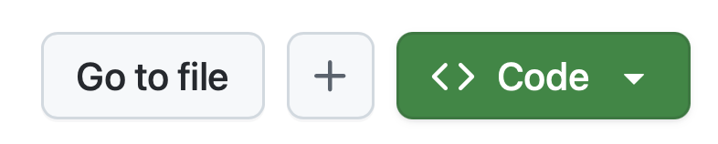

Antes de empezar los ejercicios del agente de Copilot en la nube, prepara todo lo necesario. Crearás tu propia copia del repositorio de Tailspin Toys e iniciarás un [codespace][codespaces] para editar archivos de instrucciones y revisar el trabajo del agente.

## Configura el repositorio del laboratorio

Para crear una copia del repositorio donde desarrollarás el código, crearás una instancia a partir de la [plantilla][template-repository]. La nueva instancia incluirá todos los archivos necesarios para el laboratorio y la utilizarás durante los ejercicios.

1. En una ventana nueva del navegador, abre la [plantilla de Tailspin Toys][tailspin-template].
2. Crea tu propia copia del repositorio seleccionando el botón **Use this template** en la página del repositorio del laboratorio. A continuación, selecciona **Create a new repository**.

    

3. Si participas en un evento organizado por GitHub o Microsoft, sigue las instrucciones de los mentores. De lo contrario, puedes crear el repositorio en una organización donde tengas acceso a GitHub Copilot.

    

4. Anota la ruta del repositorio que has creado (**organization-or-user-name/repository-name**), porque la necesitarás más adelante en el laboratorio.

## Crea un codespace

A continuación, utilizarás un codespace para completar los ejercicios del laboratorio.

[GitHub Codespaces][codespaces] es un entorno de desarrollo en la nube que te permite escribir, ejecutar y depurar código directamente en el navegador. Proporciona un IDE completo con compatibilidad con varios lenguajes de programación, extensiones y herramientas.

1. Abre el repositorio que acabas de crear.
2. Selecciona el botón verde **Code**.

    

3. Selecciona la pestaña **Codespaces** y, después, el botón **+** para crear un codespace.

    

La creación del codespace tardará varios minutos, aunque sigue siendo mucho más rápida que instalar todos los servicios manualmente. Mientras tanto, puedes explorar otras funciones de GitHub Copilot, que veremos a continuación.

> [!CAUTION]
> Volverás al codespace en un ejercicio posterior. Por ahora, déjalo abierto en una pestaña del navegador.

> [!NOTE]
> Este taller está diseñado para ejecutarse en un codespace o en un [contenedor de desarrollo][dev-containers] local. Ambos entornos incluyen todos los requisitos previos necesarios para que la experiencia sea fluida. Si prefieres trabajar localmente, abre el repositorio clonado en VS Code y selecciona **Reopen in Container** cuando aparezca el aviso. VS Code creará el mismo contenedor de desarrollo que utiliza el codespace.

[codespaces]: https://github.com/features/codespaces
[dev-containers]: https://code.visualstudio.com/docs/devcontainers/containers

## Resumen

¡Enhorabuena! Has creado una copia del repositorio del laboratorio. También has iniciado la creación del codespace que utilizarás para trabajar con el agente de Copilot en la nube.

## Paso siguiente

Añadamos instrucciones personalizadas que seguirá el agente en la nube. Continúa con el [ejercicio 1: Instrucciones personalizadas][next-lesson].

## Recursos

- [Información general sobre GitHub Codespaces][codespaces]
- [Crear un repositorio a partir de una plantilla][template-repository]
- [Introducción a Codespaces][codespaces-quickstart]

[tailspin-template]: https://github.com/github-samples/tailspin-toys
[template-repository]: https://docs.github.com/repositories/creating-and-managing-repositories/creating-a-template-repository
[codespaces-quickstart]: https://docs.github.com/codespaces/getting-started/quickstart
[next-lesson]: ../1-custom-instructions/
