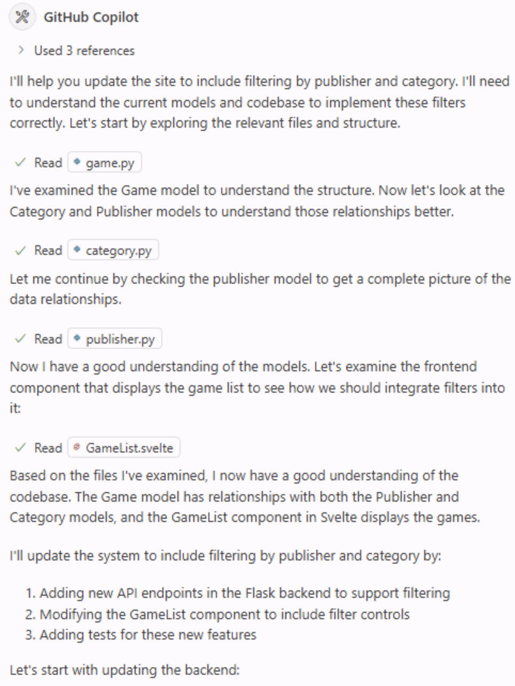

Até as atualizações mais simples de um aplicativo normalmente exigem mudanças em vários arquivos e operações, como executar testes. O fluxo de trabalho de uma pessoa desenvolvedora costuma envolver localizar todos os arquivos necessários, fazer as mudanças, executar testes, depurar, descobrir qual arquivo não foi atualizado e fazer outra alteração... E a lista continua.

É para isso que serve o modo de agente do Copilot.

O modo de agente do Copilot foi criado para trabalhar de forma mais autônoma no IDE. Ele se comporta de maneira semelhante a uma pessoa desenvolvedora: começa explorando a estrutura do projeto, faz as atualizações necessárias, executa tarefas como testes e corrige automaticamente os problemas encontrados. Vamos explorar como usar o modo de agente para adicionar uma funcionalidade ao site.

> [!NOTE]
> Apesar dos nomes parecidos, o modo de agente e o agente de nuvem são experiências diferentes. O modo de agente executa tarefas no seu IDE, permitindo ciclos rápidos de comentários e interação. O agente de nuvem foi criado para atuar como uma pessoa parceira de programação, trabalhando de forma assíncrona com issues e pull requests.

Neste exercício, você aprenderá como:

- o modo de agente do Copilot pode explorar o projeto, identificar arquivos relevantes e coordenar mudanças.
- o modo de agente do GitHub Copilot pode implementar novos recursos na interface e na camada de dados.
- revisar as mudanças e os testes gerados pelo modo de agente do Copilot antes de mesclá-los à base de código.

## Cenário

À medida que a lista de jogos cresce, você quer permitir que as pessoas usuárias filtrem por categoria e editora. Você já adicionou um helper de editoras no exercício anterior e agora concluirá o trabalho restante na camada de dados, na interface e nos testes com o modo de agente do Copilot.

## Execute o site Tailspin Toys

Antes de fazer mudanças, vamos explorar o site Tailspin Toys para entender a funcionalidade atual.

O site é uma plataforma de financiamento coletivo de jogos de tabuleiro com tema de desenvolvimento. Ele permite listar jogos e exibir os detalhes de cada um. O site é um único aplicativo Astro que renderiza as páginas como HTML estático durante a compilação. As páginas consultam um banco de dados SQLite local diretamente no frontmatter por meio do Drizzle ORM — não há uma API de backend separada nem um framework de interface executado no cliente. Os helpers de acesso a dados reutilizáveis ficam em `src/lib/`, e toda interatividade é adicionada com um pequeno `<script>` Astro com escopo próprio, usando APIs padrão do DOM.

### Inicie o site

Para facilitar a execução do site, há uma tarefa `npm run dev` que inicia o único servidor de desenvolvimento Astro. Você pode executá-la no GitHub Codespace seguindo estas etapas:

1. Volte ao Codespace. Você deve estar no `main` depois do exercício anterior.
2. Abra um novo terminal no Codespace pressionando <kbd>Control</kbd>+<kbd>\`</kbd> (Mac) ou <kbd>Ctrl</kbd>+<kbd>\`</kbd> (Windows/Linux).
3. Crie e selecione um novo branch para o trabalho de filtragem:

   ```bash
   git checkout main
   git pull
   git checkout -b filtering-vscode
   ```

4. Execute o comando a seguir para iniciar o site:

   ```bash
   npm run dev
   ```

   Quando o servidor de desenvolvimento Astro estiver pronto, você verá um aviso com a URL, semelhante ao exemplo abaixo:

   ```bash
   🚀 Tailspin Toys is ready!
      Astro server: http://localhost:4321
      Press Ctrl-C to stop.
   ```

> [!NOTE]
> Se uma caixa de diálogo for aberta pedindo para abrir uma janela do navegador em `http://localhost:4321`, feche-a selecionando o **x**.

5. Abra o site mantendo <kbd>Command</kbd> (Mac) ou <kbd>Ctrl</kbd> (Windows/Linux) pressionada e selecionando o endereço do servidor Astro `http://localhost:4321` no terminal.

> [!NOTE]
> No Codespaces, selecionar um link para a URL localhost no terminal redirecionará automaticamente para `https://<your-codespace-name>-4321.app.github.dev/`. Esse é um túnel privado para o Codespace, que agora está hospedando o servidor web!

### Explore o site

Depois que o site estiver em execução, explore suas funcionalidades. As principais incluem:

- **Página inicial**: exibe uma lista de jogos de tabuleiro com títulos, imagens e descrições.
- **Página de detalhes do jogo**: ao selecionar um jogo, você acessa uma página com mais informações, incluindo título, descrição, editora e categoria.

## Explore o backlog com o Copilot

> [!TIP]
> **Abra o Copilot Chat**
>
> Antes de iniciar os exercícios abaixo, volte ao Codespace, abra o painel do Copilot Chat e selecione **New Chat** para começar uma conversa limpa. O modo e o modelo variam entre exercícios — cada etapa indicará o que selecionar quando for relevante.

A implementação inicial do site funciona, mas queremos acrescentar novos recursos. Vamos começar explorando o backlog. Ao configurar o projeto usando o modelo, um backlog de issues foi criado automaticamente — peça ao GitHub Copilot que mostre esses itens.

1. Selecione **Agent** no menu suspenso de agentes na visualização Chat. O agente planeja e implementa mudanças em vários arquivos de forma autônoma, executa comandos de terminal e chama ferramentas.

   

2. Selecione **Claude Sonnet 4.5** na lista de modelos disponíveis.

> [!CAUTION]
> Os autores deste workshop não estão indicando preferência por um modelo específico. Durante a criação do workshop, usamos o Claude Sonnet 4.5 e o incluímos nas instruções na esperança de que as sugestões de código fossem relativamente consistentes e proporcionassem uma boa experiência. No entanto, como os LLMs são probabilísticos, as sugestões podem ser diferentes das indicadas no workshop. Isso é normal e esperado.

> [!NOTE]
> Devido à natureza probabilística dos LLMs, o Copilot pode usar um comando MCP diferente, mas ainda deverá concluir a tarefa.

3. Peça ao Copilot que mostre o backlog de issues usando o prompt:

   ```plaintext
   Please show me the backlog of items from my GitHub repository. Help me prioritize them based on those which will be most useful to the user.
   ```

4. Selecione **Continue** para executar o comando que lista todas as issues.
5. Revise a lista gerada.

Observe que o Copilot priorizou os itens com base naquilo que acredita ser mais útil para as pessoas usuárias.

## Revise os arquivos de instruções

Antes de pedir ao agente que gere código, é um bom momento para revisar o arquivo de instruções que fornecerá contexto ao Copilot. Vamos usar o arquivo de [interface do usuário (UI)](https://github.com/github-samples/tailspin-toys/blob/main/.github/instructions/ui.instructions.md), que contém contexto sobre como adicionar funcionalidades ao site.

1. No Codespace, navegue até `.github/instructions/ui.instructions.md`.
2. Observe as orientações gerais para adicionar funcionalidades. Elas incluem:
   - uma visão geral da arquitetura.
   - princípios de design de componentes, testabilidade e acessibilidade.
   - links para arquivos de instruções específicos para vários tipos de arquivo, incluindo:
     - Astro.
     - Tailwind CSS.
     - Drizzle.

> [!TIP]
> Os arquivos de instruções permitem fazer referência a outros arquivos de instruções e a arquivos do projeto. Os caminhos são relativos ao local do arquivo de instruções. Isso permite reutilizar conteúdo, dividir conjuntos maiores de instruções em arquivos menores e mais fáceis de gerenciar e indicar exemplos e modelos para o Copilot.

## Implemente a funcionalidade de filtragem

Para concluir a filtragem, será necessário fazer pelo menos três atualizações diferentes no aplicativo:

- adicionar ou refinar a lógica de filtragem na camada de dados (`src/lib/`).
- adicionar ou atualizar testes do comportamento de filtragem.
- atualizar a página de listagem de jogos para incluir a interface de filtragem.

Além disso, os testes precisam ser executados e aprovados antes de mesclar as mudanças à base de código. O modo de agente do Copilot pode realizar essas tarefas. Vamos adicionar a funcionalidade.

1. Continue na conversa atual do Copilot ou selecione **New Chat** para começar uma nova.
2. Selecione **Add Context**, **Instructions** e **ui** como arquivo de instruções.

   

3. Confirme que **Agent** continua selecionado no menu suspenso de agentes da visualização Chat.

   

4. Confirme que **Claude Sonnet 4.5** continua selecionado como modelo.
5. Peça ao Copilot que implemente a funcionalidade de acordo com a issue relacionada no backlog usando o prompt:

   ```plaintext
   Please update the site to include filtering by publisher and category based on the requirements from the related GitHub issue in the backlog. A publishers helper already exists from the previous exercise, so preserve and refine that work as needed while completing the remaining data-layer, UI, and tests. Ensure all tests are passing before completion. The server is already running, so you do not need to start it up.
   ```

6. Acompanhe o Copilot enquanto ele explora o projeto e localiza os arquivos relacionados à funcionalidade. Ele deverá encontrar tanto os helpers da camada de dados quanto a interface e os testes. Em seguida, começará a modificar os arquivos e executar os testes.

   

> [!NOTE]
> Você verá o Copilot executar várias tarefas, como explorar o projeto, modificar arquivos e executar testes. Isso pode levar alguns minutos, dependendo da complexidade da tarefa e da base de código. Durante o processo, os botões **Keep** e **Undo** podem aparecer no editor. Quando o Copilot terminar, você verá **Keep** ou **Undo** para todas as mudanças; não é necessário selecioná-los enquanto o trabalho estiver em andamento.

7. Quando solicitado pelo Copilot, selecione **Continue** para executar os testes.

   

8. Talvez ocorram pausas e alguns testes falhem durante o processo. Tudo bem! O Copilot alterna entre a geração de código e os testes até concluir a tarefa e não detectar erros.

   

9. Explore o código gerado e procure possíveis problemas.

> [!CAUTION]
> Lembre-se: é sempre importante revisar o código gerado pelo Copilot ou por qualquer ferramenta de IA.

10. Volte ao navegador com o site em execução e explore a nova funcionalidade!
11. Depois de confirmar que tudo funciona e revisar o código, selecione **Keep** na janela do Copilot Chat.

## Resumo e próximas etapas

Parabéns! Neste exercício, exploramos como usar o modo de agente do GitHub Copilot para adicionar recursos ao site Tailspin Toys. Aprendemos como:

- o modo de agente do GitHub Copilot pode implementar novos recursos na interface e na camada de dados.
- o modo de agente do Copilot pode explorar o projeto, identificar arquivos relevantes e coordenar mudanças.
- revisar as mudanças e os testes gerados pelo modo de agente do Copilot antes de mesclá-los à base de código.

Agora vamos [testar seu recurso com o servidor Playwright MCP][next-lesson] e abrir um pull request.

### Exercício bônus de exploração — implemente paginação

À medida que a lista de jogos crescer, será necessário habilitar a paginação. Usando as habilidades aprendidas neste exercício, peça ao Copilot que atualize o site para implementar paginação. Alguns aspectos a considerar:

- siga as boas práticas existentes, incluindo os arquivos de instruções.
- pense em como deseja implementar a paginação: se a pessoa usuária poderá selecionar o tamanho da página ou se ele será fixo.
- ao criar o prompt, forneça ao Copilot as orientações necessárias para implementar o comportamento desejado.
- talvez seja necessário iterar com o GitHub Copilot, pedindo mudanças e fornecendo contexto. Esse é o fluxo normal de trabalho com o Copilot!

## Recursos

- [Copilot nos modos ask, edit e agent: o que fazem e quando usá-los][choose-mode]
- [Modo de agente no VS Code][vs-code-agent-mode]

[previous-lesson]: ../1-custom-instructions/
[next-lesson]: ../3-mcp/
[choose-mode]: https://github.blog/ai-and-ml/github-copilot/copilot-ask-edit-and-agent-modes-what-they-do-and-when-to-use-them/
[vs-code-agent-mode]: https://code.visualstudio.com/docs/copilot/chat/chat-agent-mode
